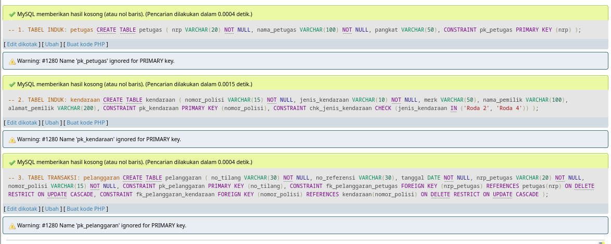

# Laporan Praktikum Sistem Basis Data

| Info | Keterangan |
| :--- | :--- |
| **Nama** | MUHAMMAD ANDY DWI SUBANDI |
| **NIM** | `264311076` |
| **Kelas** | 1C |
| **Mata Kuliah** | Praktikum Sistem Basis Data |

---

## Soal 1: Data Definition Language (DDL)

```sql
-- 1. TABEL INDUK: petugas
CREATE TABLE petugas (
    nrp          VARCHAR(20)  NOT NULL,
    nama_petugas VARCHAR(100) NOT NULL,
    pangkat      VARCHAR(50),
    CONSTRAINT pk_petugas PRIMARY KEY (nrp)
);

-- 2. TABEL INDUK: kendaraan
CREATE TABLE kendaraan (
    nomor_polisi    VARCHAR(15)  NOT NULL,
    jenis_kendaraan VARCHAR(10)  NOT NULL,
    merk            VARCHAR(50),
    nama_pemilik    VARCHAR(100),
    alamat_pemilik  VARCHAR(200),
    CONSTRAINT pk_kendaraan PRIMARY KEY (nomor_polisi),
    CONSTRAINT chk_jenis_kendaraan CHECK (jenis_kendaraan IN ('Roda 2', 'Roda 4'))
);

-- 3. TABEL TRANSAKSI: pelanggaran
CREATE TABLE pelanggaran (
    no_tilang    VARCHAR(30) NOT NULL,
    no_referensi VARCHAR(30),
    tanggal      DATE        NOT NULL,
    nrp_petugas  VARCHAR(20) NOT NULL,
    nomor_polisi VARCHAR(15) NOT NULL,
    CONSTRAINT pk_pelanggaran PRIMARY KEY (no_tilang),
    CONSTRAINT fk_pelanggaran_petugas 
        FOREIGN KEY (nrp_petugas) REFERENCES petugas(nrp)
        ON DELETE RESTRICT ON UPDATE CASCADE,
    CONSTRAINT fk_pelanggaran_kendaraan 
        FOREIGN KEY (nomor_polisi) REFERENCES kendaraan(nomor_polisi)
        ON DELETE RESTRICT ON UPDATE CASCADE
);
```

---

## Soal 2: Data Manipulation Language (DML)

```sql
-- 1. [CREATE] Insert Data Sampel
INSERT INTO petugas (nrp, nama_petugas, pangkat) VALUES
    ('81020145', 'Budi Santoso',   'Aipda'),
    ('83050231', 'Rina Wulandari', 'Bripka'),
    ('85070312', 'Agus Prasetyo',  'Briptu');

INSERT INTO kendaraan (nomor_polisi, jenis_kendaraan, merk, nama_pemilik, alamat_pemilik) VALUES
    ('AE 1234 AB', 'Roda 2', 'Honda Beat',    'Slamet Riyadi',  'Jl. Serayu No. 12, Madiun'),
    ('AE 5678 CD', 'Roda 4', 'Toyota Avanza', 'Dewi Lestari',   'Jl. Salak No. 45, Madiun'),
    ('N 9012 EF',  'Roda 2', 'Yamaha NMAX',   'Hendra Gunawan', 'Jl. Dieng No. 10, Madiun');

INSERT INTO pelanggaran (no_tilang, no_referensi, tanggal, nrp_petugas, nomor_polisi) VALUES
    ('PLS-2026-001', 'REF-A001', '2026-10-01', '81020145', 'AE 1234 AB'),
    ('PLS-2026-002', 'REF-A002', '2026-10-03', '83050231', 'AE 5678 CD'),
    ('PLS-2026-003', 'REF-A003', '2026-10-05', '85070312', 'N 9012 EF');

-- 2. [READ] Tampilkan Seluruh Isi Tabel Kendaraan
SELECT * FROM kendaraan;

-- 3. [UPDATE] Ubah Tanggal Transaksi Tilang
UPDATE pelanggaran
SET tanggal = '2026-10-02'
WHERE no_tilang = 'PLS-2026-001';

-- Cek hasil update
SELECT * FROM pelanggaran WHERE no_tilang = 'PLS-2026-001';

-- 4. [DELETE] Hapus Satu Transaksi Tilang
DELETE FROM pelanggaran
WHERE no_tilang = 'PLS-2026-003';

-- Cek hasil delete
SELECT * FROM pelanggaran;
```

---

## Soal 3: Query Kompleks & Agregasi

```sql
-- Rekapitulasi Jumlah Pelanggaran per Petugas (Periode Oktober 2026)
SELECT 
    p.nrp,
    p.nama_petugas,
    p.pangkat,
    COUNT(pl.no_tilang) AS total_pelanggaran
FROM petugas p
LEFT JOIN pelanggaran pl 
    ON p.nrp = pl.nrp_petugas 
   AND pl.tanggal BETWEEN '2026-10-01' AND '2026-10-31'
GROUP BY 
    p.nrp, 
    p.nama_petugas,
    p.pangkat
ORDER BY 
    total_pelanggaran DESC;
```

---

## Bukti Eksekusi Query

### Soal 1


### Soal 2


### Soal 3

